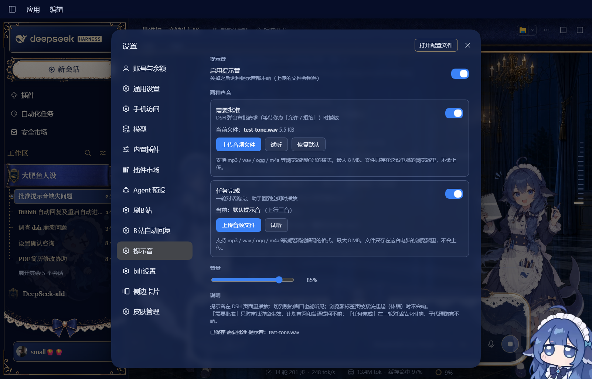

# dsh-sound-boost

给 DeepSeek Harness 加两个可以自己上传音频的提示音：

- **需要批准**：DSH 发出审批请求（等你点「允许 / 拒绝」）时响
- **任务完成**：一轮对话跑完、助手回到空闲时响

## 安装

```bash
# 1. 克隆到本地
git clone https://github.com/lll-77777777/dsh-sound-boost.git

# 2. 把本目录装进 desktop profile（本地目录用 link: + 绝对路径）
dsh plugin --profile desktop add link:<克隆下来的绝对路径>

# 3. 把插件名加进 profile 的 bundle 列表
#    C:\Users\<你>\.dsh\profiles\desktop\package.json
#    "dsh": { "profile": { "bundles": [ ... , "dsh-sound-boost" ] } }

# 4. 完全退出 DSH 再打开（host 半端只在进程启动时组装）
```

装好后打开 **设置 → 提示音**：两种提示音各自可以开关、上传音频文件、试听、恢复默认，还有总音量和总开关。

## 截图

设置页（`设置 → 提示音`）：


上传 `test-tone.wav` 之后的状态：



## 行为

- 审批只对 `approval` 类型弹窗生效；计划审阅（plan-review）和普通提问不响。
- 完成音在任意会话 `running → idle` 时响；子代理会话结束不响。
- 同一会话 2.5 秒内不重复响，避免连续事件刷屏。
- 没上传文件时用内置合成音：审批是「叮·叮」两声，完成是「C-E-G」上行三音。

## 存储

- 上传的音频：本机浏览器 IndexedDB（库名 `dsh-sound-boost`），不会上传到任何服务器。
- 开关与音量：浏览器 localStorage（键 `dsh-sound-boost:settings`）。

## 文件

| 文件 | 作用 |
| --- | --- |
| `index.js` | host 半端空壳（提示音完全在浏览器里做） |
| `client.js` | 浏览器半端：会话状态监听、播放引擎、设置页 |
| `cordis.patch.yml` | 向 profile 插入插件 row |
